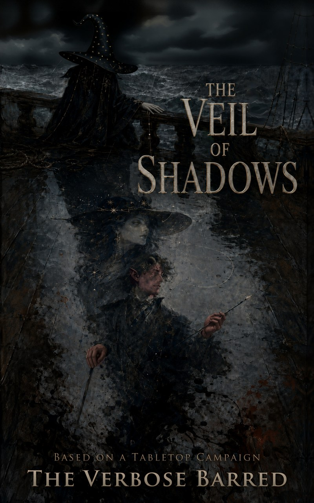

# The Veil of Shadows

*Being the Chronicle of the Traveler, in Five Parts, as set down by his own hand*

**by The Verbose Barred** · based on a tabletop campaign

## Read it free

Download the book from the **[latest release](../../releases/latest)**:

- **PDF**: for computers and printing (166 pages)
- **EPUB**: for phones, Kindle and e-readers

## About the book

A dark fantasy told as the memoir of a bard. Pulled from the sea after a battle, the traveler falls in with a starlit spymaster and her company, sails into a secret war, and finds a darkness waiting in himself.

**Five parts, 37 chapters, about 87,000 words.**

## How it started

This book began as a dare. A year and a half later, here it is. The full story is in the Author's Note at the front of the book.

## This version

This is the **Third Version** (third draft), revised October 2026.

It has been proofread only by the author and by AI, with no professional editor yet.

## A work of fiction

This is a work of fiction based on a tabletop role-playing campaign. Names, places and events have been changed or invented.

## Audiobook

The audiobook is coming, released in parts as each one is finished:

- Part One
- Part Two
- Part Three
- Part Four
- Part Five

Each chapter is its own recording. When all five parts are done, the complete audiobook will follow.

---

© 2026 The Verbose Barred. All rights reserved. Free to download and read.
